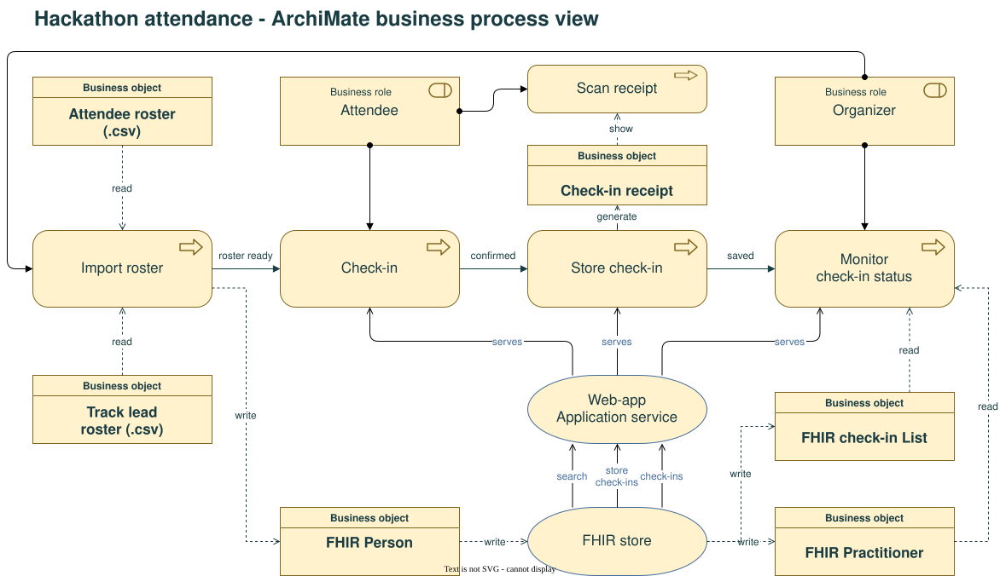

# Norwegian FHIR Hackathon 2026 check-in

Responsive attendee check-in and authenticated registration-desk tools for
November 9, 2026 at Rebel, Oslo. React/TypeScript frontend, Fastify backend,
FHIR R4 resources stored in a local JSON file, and locally generated QR attendance receipts.

The app and FHIR implementation guide are named `hackathon-check-in-app`.
The app is version `0.9.7`. Version 0.8.0 moved FHIR storage from Blaze to a
local JSON file (see [Migrating from an earlier Blaze installation](#migrating-from-an-earlier-blaze-installation));
0.8.1 identifies participants by email, adds add-only roster imports and a
preview before every web import (see [Roster imports](#roster-imports)).
Version 0.8.2 includes Partner rows from the agenda's Track leads table in the
staff roster, while excluding the separate Partners chapter.
Version 0.9.0 adds a formatted view of the saved FHIR Practitioner resource
from the check-in receipt.
Version 0.9.1 shortens maintenance confirmation phrases and adds flame icons
to the **Show FHIR data** button.
Version 0.9.5 adds a separate SSH remote-monitoring helper page linked from
the staff dashboard, with Windows network/status discovery and explicit
administrator PowerShell commands (see [Remote monitoring helper](OPERATIONS.md#dashboard-ssh-helper)).
Version 0.9.6 adds an authenticated **Download all FHIR data** button to the
staff dashboard, exporting all currently stored resources as a FHIR collection Bundle.
Version 0.9.7 highlights attendee and staff-roster check-in counts in a separate
dashboard row and orders receipt buttons as **Done / clear receipt**, **Keep receipt open**,
then **Show FHIR data**, together in a centered group.
The IG is version `0.9.1`; its FHIR definitions are unchanged.
Installations older than 0.6.0 must follow the
[0.6.0 upgrade guidance](DESIGN.md#upgrading-to-060) before using the renamed
FHIR namespace.

## Features



[Edit the process diagram in draw.io](fhir/input/images-source/attendance-process.drawio).
The view includes business-layer roles, processes and objects, and a Web-app
application service serving Check-in, Store check-in and Show check-in status.
The attendee role performs Check-in; the organizer role imports rosters and
views check-in status. The organizer roster is the app's staff roster.

* Live fuzzy name matching after five letters, optional affiliation refinement,
  unchecked-in matches first and already checked-in matches last, ranked by
  relevance within each group. Checked-in tiles have a distinct color and an
  "Already checked in" label, and remain selectable for receipt retrieval.
  Explicit selection and email/track prefill.
* Editable confirmed primary track and transactional check-in.
* Google Sheet and organizer-reviewed agenda CSV imports into Person rosters.
* Linked Practitioners for actual arrivals, with attendee/track-lead qualification.
* Staff login, FHIR-backed counts, track totals, corrections, manual registration,
  receipt retrieval and CSV export.
* Audited single-participant roster changes from the organizer dashboard for
  last-minute sign-ups and cancellations, without a full CSV reimport.
* A readable attendance receipt and locally generated `mailto:` QR code after
  check-in that opens a pre-filled confirmation email to the attendee on iPhone
  and Android, including original arrival time and registered details.
* FSH profiles, terminology, synthetic examples and a generated validation package.

For day-to-day use, follow the [Operations guide](OPERATIONS.md): starting and
stopping the app, changing rosters, installing application updates, resetting
attendance after a rehearsal, and monitoring check-ins remotely.
See [Design choices](DESIGN.md) for architecture, FHIR modeling, receipt design
and migration guidance for older deployments.

## Windows setup

Use a supported Windows version and Node.js 22 or newer (a maintained LTS
release is recommended). No Docker, WSL, Java or database server is needed.

```powershell
Set-Location 'D:\Programdisk-2\GitRepo\hackathon-check-in-app'
.\scripts\Install-Prerequisites.ps1
.\scripts\Install-App.ps1
```

The prerequisite script installs missing Git and Node.js LTS/npm using WinGet
(Microsoft App Installer is required; installers may prompt for approval).
Existing installations are not upgraded. The application installer runs
`npm ci`, builds the app and FHIR package and creates `.env` interactively if
absent. It never overwrites existing configuration or starts the app. The
initial staff password prompt is visible: run it privately and use a unique
event password. Only its salted scrypt hash is saved. Restrict `.env`
permissions to event operators.

Equivalent manual steps:

```powershell
npm.cmd ci
npm.cmd run build
npm.cmd run configure
```

`npm.cmd run build` type-checks everything, builds the browser UI into `dist`
and compiles the server and command-line tools into `dist-server`. The app,
`ops`, `configure`, `staff:generate` and `migrate:blaze` run that compiled
JavaScript with plain `node`, so they need a build first and do not pick up
source changes until the next build.

## Data storage

All FHIR R4 resources (Person, Practitioner, List, AuditEvent) are kept in
memory by the app and saved as one FHIR `collection` Bundle,
`fhir-store.json`, in `DATA_DIR` (default `data` in the application folder,
ignored by Git). The directory is created on first start.

* Every change is written as a complete new file and atomically renamed over
  the previous one, so a crash or power loss leaves either the old or the new
  state, never a partial file. Concurrent check-ins are serialized and
  version-checked, so simultaneous arrivals are never lost.
* Only one process can open the data: the app holds `fhir-store.lock` while
  running. Maintenance commands refuse to write while the app is running.
  A lock left by a crashed app is detected and replaced automatically.
* Search and the dashboard read from memory, so they are fast regardless of
  network or disk speed.
* The file contains personal data in readable form. Restrict the directory's
  NTFS permissions to event operators and use BitLocker on the event PC.
  Do not put it in a OneDrive/Dropbox-synchronized folder.

To keep the data on another disk, set for example `DATA_DIR=D:\hackathon-data`
in `.env`. Relative paths are resolved against the application folder.

### Migrating from an earlier Blaze installation

Versions before 0.8.0 stored data in a Blaze FHIR server. To carry over
existing rosters and attendance, start the old Blaze container once more and
run, with an empty `DATA_DIR`:

```powershell
npm.cmd run migrate:blaze -- 'http://localhost:8090/fhir'
```

This copies the event's Lists, Persons, Practitioners and AuditEvents into
`fhir-store.json` without changing Blaze. Afterwards Blaze, Docker Desktop and
`compose.yaml` are no longer needed; keep the old Blaze data directory as an
archive until the event is over. Alternatively, simply reimport the reviewed
roster CSVs into a new installation.

## Run the application

```powershell
npm.cmd run ops -- start
# In a second PowerShell window:
npm.cmd run ops -- status
```

`start` checks that the UI is built, then runs the app in the foreground. Leave
its terminal open; **Ctrl+C** stops the app. No rebuild, dependency installation
or roster replacement is performed on ordinary startup. `npm.cmd run start` is
equivalent without the build check. See the
[Operations guide](OPERATIONS.md#operations-cli) for backups, read-only
roster/reset previews and guarded `--apply` workflows. Configuration uses
`npm.cmd run configure`; there is no web administration console.

Open `http://localhost:8080`. Startup initializes the three event Lists if
needed and preloads the bundled agenda staff roster if the staff List is empty.
Preloading creates Persons only, never check-ins, Practitioners or receipts.
Existing staff Lists are not automatically overwritten.

```powershell
Invoke-RestMethod 'http://localhost:8080/api/health'
```

The UI exposes the separate **Staff access** page; the staff roster does not grant
login rights. Staff sessions last 30 minutes and require re-login after expiry.

For development, run `npm run dev` (the server from source, restarting on
changes) and `npm run dev:ui` in separate terminals;
set `PUBLIC_URL=http://localhost:5173` for Vite's same-origin API proxy. Production
serves the built UI and API from the same backend origin.

## Configuration

See `.env.example`. Generated passwords and secrets belong only in `.env`.

* `PUBLIC_URL`: exact browser origin, used for same-origin checks and secure
  cookies. Set the final HTTPS origin for venue deployment.
* `HOST`: defaults to loopback. For LAN access, configure binding/firewall and
  a trusted HTTPS reverse proxy; expose only the HTTPS application endpoint.
* `DATA_DIR`: directory for `fhir-store.json`, its lock and default backups
  (default `data` in the application folder).
* `PRIVACY_NOTICE_URL`: link to the event privacy notice.

The 2026 event privacy notice must be updated before real use to cover check-in
timestamps, receipt contact details/QR codes, retention and the deliberately accepted matching
disclosure: suggestions reveal names/affiliations and selection reveals email and
track. Matching is convenient self-selection, not identity verification.

For workstation-only operation, open `http://localhost:8080` on the registration
PC. Attendees scan the displayed receipt, not a website URL; their phones need
neither Wi-Fi nor access to the local FHIR server.

If attendees instead open the app on their phones, they cannot use the PC's
`localhost`. Configure a reachable venue hostname,
trusted HTTPS certificate, Wi-Fi client connectivity and Windows Firewall first.
Distribute that URL as a QR code. Keep the staffed kiosk as fallback.

To follow check-ins from a second computer on the same Wi-Fi (for example a
phone hotspot), use an SSH tunnel as described in
[Monitor check-ins remotely](OPERATIONS.md#5-monitor-check-ins-remotely-over-wi-fi).
Never publish the app directly on the network.

## Roster imports

### Bundled agenda staff roster

The event agenda's **Track leads** table (also accepted as **Track leads and
partners**) is the master staff source. Include Partner rows in that table;
exclude people listed only in the separate **Partners** chapter.
Generate the distributable snapshot from that Markdown file:

```powershell
npm.cmd run staff:generate -- 'C:\GitRepo\Norwegian-FHIR-Hackathon-2026\Norwegian-FHIR-hackathon-2026\input\pagecontent\hack-agenda.md'
```

This generates `seed\staff.csv`, a matching Person Bundle in
`seed\staff-persons.json`, and source metadata/review warnings in
`seed\staff-source.json`. Review the warnings before deployment. Startup imports
the CSV; do not copy the collection Bundle into the data file.

Track-associated rows use `track-lead`, while Partner rows use `attendee` with
no primary track. Staff IDs are derived from names; reconcile IDs manually if
someone is renamed. A Google Sheet participant who is also in the staff roster
is matched by email automatically; their event role must be the same in both
lists (add a `role` column to the attendee CSV for a track lead).

After updating the master, regenerate and explicitly refresh an existing project:

```powershell
npm.cmd run ops -- import --staff '.\seed\staff.csv'            # preview
npm.cmd run ops -- import --staff '.\seed\staff.csv' --apply    # app stopped
```

By default an import replaces the staff list, removing people absent from the
latest CSV from that list (see [Replace or add only](#replace-or-add-only)).
People still in the attendee list remain in the active roster; attendance
history is preserved. The snapshot contains public personal
contact data: protect it in the deployed app, never serve `seed` as static files,
and include this distribution in the event's privacy review.

### Google Sheet attendees and optional staff updates

The Google Forms attendee CSV export can be imported directly. The importer uses
`Your name`, `E-postadresse`, `Your affiliation/employer`, and
`What primary track do you want to attend?`, maps primary-track labels to event
codes, and assigns the `attendee` event role. Other columns (including phone
numbers, professional roles, allergies and free-text answers) are not imported.
Unknown primary tracks are rejected rather than silently discarded.

Alternatively, map the needed fields to:

```csv
name,email,affiliation,track,role
Example Person,example@example.invalid,Example Org,smart,attendee
```

**People are identified by email.** Rows without an `id` get a stable ID
generated from the normalized email address (`email-` plus a hash; the address
itself is not used as the ID). Case and surrounding spaces in the email do not
matter, and name, affiliation and track can change between imports. Such a row
is also matched to an existing participant with the same email, so people
already in the staff list, added from the dashboard or imported by earlier
versions (with name-based IDs) keep their identity. An email correction is
recognized when name and affiliation are unchanged. The optional `id` column
overrides all of this: explicit IDs are used exactly as given. Ambiguous matches
(for example a row matching two existing people) are rejected, not merged.

Allowed roles: `attendee`, `track-lead`. Other partners/staff are attendees unless
confirmed as track leads; someone in both lists must have the same role in
both. Allowed track codes appear in the UI and FHIR ValueSet; an empty track is
allowed. Imports validate every row, reject duplicates and conflicting roles,
and import atomically (maximum 500 rows per import). Existing confirmed details
are not overwritten by reimports, and imports never check anyone in.
Empty/header-only CSVs are rejected; validation failures leave the list unchanged.

#### Replace or add only

By default an import **replaces** the selected list with exactly the supplied
rows, so people absent from the CSV are removed from that list. Use this with
the complete latest CSV. To only add and update people (for example with a
file containing just new sign-ups), untick **Remove people who are not in this
CSV** on the staff page, or add `--keep-missing` to `ops import`.

The active roster/search is the union of the attendee and staff lists. Removed
people keep their Person resource, any recorded check-in and export rows, but
cannot start a roster-based check-in unless they remain in the other list.
Re-adding them later reuses the existing Person and any recorded check-in.

```powershell
npm.cmd run ops -- import --attendees 'D:\private\reviewed-attendees.csv'           # preview
npm.cmd run ops -- import --attendees 'D:\private\reviewed-attendees.csv' --apply   # app stopped
```

Alternatively paste the CSV into **Import reviewed roster CSV** on the staff
page and press **Preview import**. The preview lists everyone who would be
added, updated or removed; **Apply import** applies exactly that preview (if
the list changed in between, you are asked to preview again) and saves a backup
to `DATA_DIR\backups` first. Unlike `ops import --apply`, the app can keep
running.

### Last-minute single additions and removals

For individual changes close to or during the event, the organizer dashboard
can add or remove one person at a time without replacing a list:

* **Add to list without check-in** uses the manual-registration fields (name,
  email, affiliation, track, verified role and an audit reason) but only adds
  the person to the selected attendee or staff List. Nothing is checked in; the
  person then checks in from the attendee page like everyone else. The stable
  ID is generated from the email exactly as for CSV rows without an `id`, so a
  later import containing the same email recognizes the same Person. If
  someone with the same email, or the same name and affiliation,
  already exists (for example in the other list), that Person is reused rather
  than duplicated; the roles must agree, and details confirmed at check-in are
  never overwritten. Adding someone already in the selected list is rejected.
* **Remove from attendee list / staff list** appears after selecting a person
  in the staff search or **Correct details** in the arrivals table. It removes
  only the entry in that List, mirroring a reimport without that row: the
  Person, any recorded check-in, receipt and export rows are kept, and the
  person stays searchable if still in the other list. Removal from both lists
  stops roster-based check-in, including with an earlier selection token.

Every single change writes an AuditEvent with the staff username and reason.
Keep the reviewed CSV sources aligned afterwards: the next replacing import of
a list keeps exactly the CSV rows, so a person added only through the dashboard
disappears from that list unless the CSV also includes them (an add-only import
keeps them).

Synthetic samples are in `examples`, with reserved `example.invalid` addresses.
Do not import samples into the real event project.
Import does not create Practitioners or check anyone in.

## FHIR data and validation

The staff dashboard displays **Attendees checked in** and **Staff checked in**
first, in a separate highlighted row. Attendees counts the attendee role;
staff counts checked-in people on the current staff roster, regardless of
role. These counts can overlap when staff-roster members have the attendee
role. Track-lead counts and the remaining totals appear in the row below.

In the staff dashboard, **Download all FHIR data** saves
`hackathon-2026-fhir.json`, a FHIR R4 `Bundle` of type `collection` containing
every resource currently in the application's store: roster and participant
records, check-in Practitioners, Lists and retained AuditEvents. Resource IDs,
references and metadata are preserved. Downloading does not change the data
or interrupt check-in. Staff authentication is required; failures are shown
in the dashboard instead of downloading an error as data.

The file contains personal data, including roster members who have not checked
in and retained audit details. Store and share it securely. It is a snapshot,
not a version-history export: deleted resources and older resource versions
are not included. It excludes application credentials, configuration and
previous backup files. The demo downloads only its current synthetic
browser-tab data. Continue using the operations backup command for verified
on-disk backups.

Sources are under `fhir`; generated content is ignored by Git.

```powershell
npm.cmd run fhir:build
npm.cmd run fhir:package
```

This produces `fhir\output\package.tgz`, consumed by the full validation command:

```powershell
$env:FHIR_VALIDATOR_JAR = 'D:\tools\validator_cli.jar'
npm.cmd run fhir:fixtures
npm.cmd run fhir:validate
```

Use the official [HL7 validator](https://github.com/hapifhir/org.hl7.fhir.core/releases)
and a compatible Java runtime. Validation runs locally with external terminology
lookups disabled; inspect `fhir\output\validation.json`. The fixture command also
exports synthetic resources from the actual check-in service, including manual
registration and audit, so validation covers runtime output as well as FSH examples.
For an HTML IG, run IG Publisher using `fhir\ig.ini`.
See [FHIR model and validation](DESIGN.md#fhir-model-and-validation) for resource
relationships and package identifiers.

### Static demo with the IG examples

`npm.cmd run build:demo` builds a server-free demo into `dist-demo`. It runs SUSHI
first, then bundles the synthetic `Person`, `Practitioner` and `List` examples from
`fhir\fsh-generated\resources` into the app. In the browser, the real registration
service runs against an in-memory store, so check-in, receipts, organizer dashboard,
manual registration, single roster additions/removals, corrections, CSV export and full FHIR download
all work. Data resets on reload. The
IG example roster `synthetic-attendee-roster` is mapped to the event roster in memory.
Staff sign-in accepts any credentials, and roster CSV import is disabled.
Run `npm.cmd run dev:demo` to try it locally; add `#staff` to the URL for the
organizer screen.

The *Build and publish FHIR Implementation Guide* workflow builds the demo and
publishes it with the IG on GitHub Pages under `demo/`. The IG's *Demo* page links
to it.

## QR attendance receipts

Successful check-in shows a receipt with registered details, event role, primary
track, event date/location, original arrival time in Europe/Oslo and a stable
receipt reference. The QR contains a standard `mailto:` link addressed to the
attendee's registered email, with the subject "Norwegian FHIR Hackathon 2026
check-in confirmation" and a compact body: name, primary-track code, arrival time
and receipt reference. The full event details, affiliation and role remain on
screen but are omitted from the QR to reduce its density. It is generated locally
and works without internet access.

Ask the attendee to scan the code with their phone camera. iPhone Camera and
Android Camera/Google Lens offer to open the pre-filled email in the default mail
app; the attendee taps **Send** to keep the receipt in their own mailbox. Sending
requires a configured mail app and network access on the attendee's phone. Older
Android phones may need Google Lens or a QR reader app. Attendees can always
photograph the readable receipt instead. Long names produce denser codes;
rehearse scanning at the workstation's actual screen size.

The receipt clears after 120 seconds for shared-workstation privacy. **Keep
receipt open** restarts that period; **Done / clear receipt** clears it immediately
and appears immediately before **Keep receipt open**. The three buttons are
grouped together, with **Done / clear receipt** leftmost and **Show FHIR data**
rightmost, rather than aligning the Done button separately to the screen edge.
**Show FHIR data** opens a dialog with the saved FHIR Practitioner resource as
formatted JSON, including its ID and metadata, and restarts the receipt timer.
Close it with **Close FHIR data** or Escape. It clears with the receipt when the
timer expires. The resource contains personal data; keep any saved copy private.
These controls appear only at the bottom of the receipt, not in the page header.
The shared page header uses a locally bundled
[HL7 Norway logo](https://github.com/HL7Norway/best-practice/blob/master/assets/images/logo.png),
so displaying it does not require internet access.
The shared header displays the welcome heading, event date and venue on every
page, including receipts and staff pages.
Manual registrations show the same receipt. Staff can use **Show receipt** in
the arrivals table to reopen a receipt, including after correcting details,
without registering again. Only the selected receipt is displayed, not the
dashboard containing other attendees.

If QR rendering fails, the saved check-in remains valid; an explicit error,
retry button and readable details remain available. If FHIR persistence or
receipt retrieval fails, an error is shown rather than fabricated confirmation.
Retrying check-in is idempotent.

Receipts confirm check-in, not full-event attendance, identity or professional
credentials. They are not digitally signed. They include personal contact
details: keep screenshots/private copies secure and clear the screen between
attendees. Existing name matching is not identity verification.

## Verification and event operation

```powershell
npm.cmd test
npm.cmd run build
```

Before event day, also rehearse on the event PC:

1. Two simultaneous check-ins and a duplicate resubmission.
2. A staff-only track lead and someone in both rosters.
3. Manual registration, corrections, CSV export and reopening receipts.
4. Adding a late sign-up to the attendee list from the dashboard, checking them
   in from the attendee page, and removing a cancelled person from the list.
5. Internet outage, app restart, killing the app process and PC reboot.
6. Scan a real receipt using iPhone/Android, including long details; verify
   saved text, offline scanning, original timestamp, and workstation clearing.
7. Local workstation access; trusted HTTPS if offering phone-based registration.
8. Private backup and restore to a separate test instance.

### Backup and restore

`npm.cmd run ops -- backup` copies `fhir-store.json` to `DATA_DIR\backups`
(or `--backup-dir`) and verifies the copy. It can run while the app is
running, because the app always replaces the file atomically. Every maintenance
`--apply` also takes a backup first. Take backups at agreed intervals (for
example after the morning rush and at the end of the day) and copy them to a
second, encrypted disk; `DATA_DIR\backups` alone does not protect against loss
of the data disk. Protect backups as personal data, and retain `.env` securely
for recovery.

To restore, stop the app (Ctrl+C), move the current `fhir-store.json` aside
(do not delete it), copy the chosen backup to `DATA_DIR\fhir-store.json`,
start the app and verify the dashboard. To rehearse a restore, point
`DATA_DIR` at an empty test directory instead.

The data file is itself a standard FHIR R4 collection Bundle, so it can be read
by FHIR tools or loaded into any FHIR server.

Data is deleted only by deleting `DATA_DIR` and its backups; do so only after
the approved retention date. Document the retention/deletion date.
