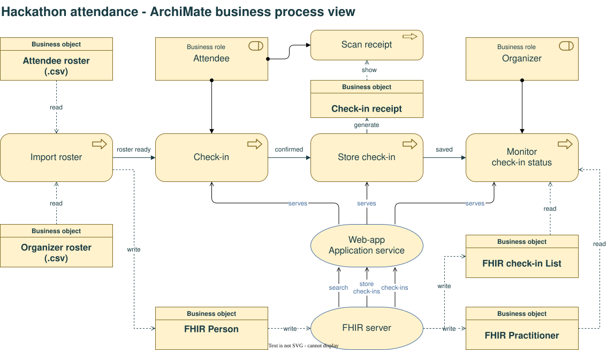

# Norwegian FHIR Hackathon 2026 check-in

Responsive attendee check-in and authenticated registration-desk tools for
November 9, 2026 at Rebel, Oslo. React/TypeScript frontend, Fastify backend,
Blaze FHIR R4 server persistence, and locally generated QR attendance receipts.

## Features



[Edit the process diagram in draw.io](docs/attendance-process.drawio).
The view includes business-layer roles, processes and objects, and a Web-app
application service serving Check-in, Store check-in and Show check-in status.
The attendee role performs Check-in; the organizer role imports rosters and
views check-in status. The organizer roster is the app's staff roster.

* Live fuzzy name matching after five letters, optional affiliation refinement,
  unchecked-in matches first and already checked-in matches last, ranked by
  relevance within each group. Checked-in tiles have a distinct color and an
  "Already checked in" label, and remain selectable for receipt retrieval.
  Explicit selection and email/track prefill.
* Editable confirmed primary track and transactional check-in.
* Google Sheet and organizer-reviewed agenda CSV imports into Person rosters.
* Linked Practitioners for actual arrivals, with attendee/track-lead qualification.
* Staff login, FHIR-backed counts, track totals, corrections, manual registration,
  receipt retrieval and CSV export.
* A readable attendance receipt and locally generated plain-text QR code after
  check-in, including original arrival time and registered details.
* FSH profiles, terminology, synthetic examples and a generated validation package.

For day-to-day use, follow the [Operations guide](OPERATIONS.md): starting and
stopping the app, changing rosters, installing application updates, resetting
attendance after a rehearsal, and monitoring check-ins remotely.
See [Design choices](DESIGN.md) for architecture, FHIR modeling, receipt design
and migration guidance for older deployments.

## Windows setup

Use a supported Windows version, hardware virtualization and Docker Desktop with
the WSL 2 backend and Linux containers. Confirm Docker Desktop licensing for your
organization. Use a maintained Node.js LTS release; the application currently
supports Node.js 18.17+ for compatibility with the development PC.

```powershell
Set-Location 'D:\Programdisk-2\GitRepo\hackaton-registration-app'
.\scripts\Install-Prerequisites.ps1
```

This installs missing Git, Node.js LTS/npm and Docker Desktop using WinGet.
Existing installations are not upgraded automatically. WinGet needs Microsoft
App Installer. Installers may prompt for approval, licenses and restarts.
The script does not change execution policy or accept licenses automatically.

If needed, run `wsl --install` in administrator PowerShell, restart when requested,
then complete Docker Desktop setup. For existing WSL installations, diagnose with
`wsl --status` and update with `wsl --update` if required. Start Docker Desktop and
wait for the engine before proceeding.

```powershell
.\scripts\Install-Prerequisites.ps1 -CheckOnly
.\scripts\Install-App.ps1
```

The application installer runs `npm ci`, builds the app and FHIR package, creates
`.env` interactively if absent, validates Compose and pulls the pinned Blaze image.
It never overwrites existing configuration or starts services. The initial staff
password prompt is visible: run it privately and use a unique event password.
Only its salted scrypt hash is saved. Restrict `.env` permissions to event operators.
For dependency installation without image downloads, pass `-SkipImages`.

Equivalent manual steps:

```powershell
npm.cmd ci
npm.cmd run configure
npm.cmd run build
npm.cmd run fhir:build
npm.cmd run fhir:package
npm.cmd run fhir:fixtures
docker compose pull
```

## Start the Blaze FHIR server

The FHIR backend is [Blaze](https://github.com/samply/blaze) `samply/blaze:1.11.0`
(standalone RocksDB storage, FHIR R4), defined in `compose.yaml`. It is the only
container: no separate database, cache or administration app is needed.

### Store the database on the host disk

Blaze stores its database in a **bind-mounted directory on the host disk**,
outside the container. Keep this directory when stopping or upgrading services.

The host directory is set by `BLAZE_DATA_DIR` in `.env` (default
`./data/blaze`, relative to the repository; `data/` is ignored by Git). Compose
uses `create_host_path: false`, so you must create the directory before the first
start; a typo then fails loudly instead of silently starting an empty database.
Use an empty directory for a new database.

```powershell
# Default location inside the repository:
New-Item -ItemType Directory -Force '.\data\blaze'

# Or a dedicated, access-restricted data disk (recommended for the event):
New-Item -ItemType Directory -Force 'D:\hackathon-data\blaze'
# then in .env:  BLAZE_DATA_DIR=D:/hackathon-data/blaze
```

Use forward slashes or a quoted absolute path for `BLAZE_DATA_DIR` on Windows.
Restrict the directory's NTFS permissions to event operators: it contains
personal data in readable form (Blaze does not encrypt data at rest); use
BitLocker on the event PC.

Notes:

* The container runs as UID 1001. With Docker Desktop on Windows, bind-mounted
  Windows folders are writable without further steps. On a Linux host run
  `sudo chown -R 1001:1001 <dir>` once.
* Rehearse startup and check-in speed on the event PC. See
  [Storage design](DESIGN.md#storage-and-transactions) for WSL storage options.
* Never point two Blaze containers at the same directory at once.
* Do not put the directory in a OneDrive/Dropbox-synchronized folder; sync tools
  can corrupt open RocksDB files.

### Start and check

```powershell
docker compose up -d
docker compose ps
Invoke-RestMethod 'http://localhost:8090/health'
Invoke-RestMethod 'http://localhost:8090/fhir/metadata' | Select-Object -ExpandProperty software
```

Startup takes 10–60 seconds; `docker compose ps` shows `healthy` when ready.
Check that files appeared in the host directory (for example
`Get-ChildItem .\data\blaze`).

Blaze listens on container port 8080; Compose publishes it **only on loopback**
as `127.0.0.1:8090`, because the registration app already uses 8080. Blaze runs
**without authentication**: never change the port mapping to `0.0.0.0`, never
forward it through a firewall or reverse proxy, and never expose it to the venue
Wi-Fi. Phones and browsers only talk to the registration backend, which is the
only Blaze client. Set `FHIR_BASE_URL=http://localhost:8090/fhir` in `.env`.
Keep `BASE_URL` in `compose.yaml` aligned with the host side
(`http://localhost:8090`) so search paging works.

Compose sets a 2 GB JVM heap (`JAVA_TOOL_OPTIONS=-Xmx2g`) plus a 256 MiB RocksDB
block cache; allow about 3 GB RAM for Docker Desktop's WSL VM.

Verify transaction/conditional-create behavior, version conflicts, backup
restore and resource use on the event PC before admitting real attendees.
See the [Blaze documentation](https://samply.github.io/blaze/) for configuration
options.

## Run the application

```powershell
npm.cmd run start
```

Open `http://localhost:8080`. Startup checks Blaze, initializes the three
event Lists if needed, and preloads the bundled agenda staff roster if the staff
List is empty. Preloading creates Persons only, never check-ins, Practitioners
or receipts. Existing staff Lists are not automatically overwritten.
A failed startup is an error, never an offline mock mode.

```powershell
Invoke-RestMethod 'http://localhost:8080/api/health'
```

Health checks include a Blaze List query.
The UI exposes the separate **Staff access** page; the staff roster does not grant
login rights. Staff sessions last 30 minutes and require re-login after expiry.

For development, run `npm run dev` and `npm run dev:ui` in separate terminals;
set `PUBLIC_URL=http://localhost:5173` for Vite's same-origin API proxy. Production
serves the built UI and API from the same backend origin.

## Configuration

See `.env.example`. Generated passwords and secrets belong only in `.env`.

* `PUBLIC_URL`: exact browser origin, used for same-origin checks and secure
  cookies. Set the final HTTPS origin for venue deployment.
* `HOST`: defaults to loopback. For LAN access, configure binding/firewall and
  a trusted HTTPS reverse proxy; expose only the HTTPS application endpoint.
* `FHIR_BASE_URL`: Blaze FHIR base including `/fhir`
  (default `http://localhost:8090/fhir`). Must stay a loopback address.
* `BLAZE_DATA_DIR`: host directory for the Blaze database files, used by
  `compose.yaml` (default `./data/blaze`). Must exist before `docker compose up`.
* `PRIVACY_NOTICE_URL`: link to the event privacy notice.

The 2026 event privacy notice must be updated before real use to cover check-in
timestamps, receipt contact details/QR codes, retention and the deliberately accepted matching
disclosure: suggestions reveal names/affiliations and selection reveals email and
track. Matching is convenient self-selection, not identity verification.

For workstation-only operation, open `http://localhost:8080` on the registration
PC. Attendees scan the displayed receipt, not a website URL; their phones need
neither Wi-Fi nor access to the local FHIR server.

If attendees instead open the app on their phones, they cannot use the PC's
`localhost`. Configure a reachable venue hostname,
trusted HTTPS certificate, Wi-Fi client connectivity and Windows Firewall first.
Distribute that URL as a QR code. Keep the staffed kiosk as fallback.

To follow check-ins from a second computer on the same Wi-Fi (for example a
phone hotspot), use an SSH tunnel as described in
[Monitor check-ins remotely](OPERATIONS.md#5-monitor-check-ins-remotely-over-wi-fi).
Never publish the app or Blaze directly on the network.

## Roster imports

### Bundled agenda staff roster

The event agenda's **Track leads and partners** table is the master staff source.
Generate the distributable snapshot from that Markdown file:

```powershell
npm.cmd run staff:generate -- 'D:\Programdisk-2\GitRepo\Norwegian-FHIR-Hackathon-2026\Norwegian-FHIR-hackathon-2026\input\pagecontent\hack-agenda.md'
```

This generates `seed\staff.csv`, a matching Person Bundle in
`seed\staff-persons.json`, and source metadata/review warnings in
`seed\staff-source.json`. Review the warnings before deployment. Startup imports
the CSV; do not POST the collection Bundle directly to Blaze.

Track-associated rows use `track-lead`, while Partner rows use `attendee` with
no primary track. Stable IDs are derived from names and are independent of email;
reconcile IDs manually if someone is renamed.
For a Google Sheet participant who is also in the staff roster, use the same
bundled ID and role when preparing that attendee CSV.

After updating the master, regenerate and explicitly refresh an existing project:

```powershell
npm.cmd run import -- staff '.\seed\staff.csv'
```

Each import replaces the staff list, removing people absent from the latest CSV
from that list. People still in the attendee list remain in the active roster;
attendance history is preserved. The snapshot contains public personal
contact data: protect it in the deployed app, never serve `seed` as static files,
and include this distribution in the event's privacy review.

### Google Sheet attendees and optional staff updates

The Google Forms attendee CSV export can be imported directly. The importer uses
`Your name`, `E-postadresse`, `Your affiliation/employer`, and
`What primary track do you want to attend?`, maps primary-track labels to event
codes, and assigns the `attendee` event role. Other columns (including phone
numbers, professional roles, allergies and free-text answers) are not imported.
Unknown primary tracks are rejected rather than silently discarded.

Alternatively, map the needed fields to:

```csv
name,email,affiliation,track,role
Example Person,example@example.invalid,Example Org,smart,attendee
```

The optional `id` column is a stable participant key, not an email address or
Blaze resource ID. Missing or empty IDs are generated as `roster-` plus a hash
of normalized name and affiliation. IDs are deterministic across repeat imports,
row ordering, email corrections and track changes. Keep name and affiliation
unchanged on reimport, or supply the previously generated ID when correcting them.
Explicit IDs remain unchanged. For anyone already in the staff roster, add `id`
and `role` columns with the bundled ID and event role, including when using the
Google Forms export. Ambiguous overlaps are rejected, not automatically merged.
Allowed roles: `attendee`, `track-lead`. Other partners/staff are attendees unless
confirmed as track leads. Allowed track codes appear in the UI and FHIR ValueSet;
an empty track is allowed. Imports validate every row, reject ambiguous duplicates
and conflicting roles, and import atomically (maximum 500 rows per import).
Existing confirmed details are not overwritten by reimports. Every import
replaces the selected list with exactly the supplied rows: always import the
complete latest CSV, not a file containing only changes. People absent from that
CSV are removed from that list. The active roster/search is the union of the
latest attendee and staff lists; import both CSVs if both have changed.
Person resources and recorded check-ins are retained, so removed people may
still appear in attendance history and exports, but cannot start a roster-based
check-in unless they remain in the other list. Re-adding a stable ID reuses the
existing Person and any recorded check-in. Empty/header-only CSVs are rejected;
validation or transaction failures leave the previous list unchanged.

```powershell
npm.cmd run import -- roster 'D:\private\reviewed-attendees.csv'
npm.cmd run import -- staff 'D:\private\reviewed-staff.csv'
```

Alternatively paste CSV in the authenticated staff page.

Synthetic samples are in `examples`, with reserved `example.invalid` addresses.
Do not import samples into the real event project.
Import does not create Practitioners or check anyone in.

## FHIR data and validation

Sources are under `fhir`; generated content is ignored by Git.

```powershell
npm.cmd run fhir:build
npm.cmd run fhir:package
```

This produces `fhir\output\package.tgz`, consumed by the full validation command:

```powershell
$env:FHIR_VALIDATOR_JAR = 'D:\tools\validator_cli.jar'
npm.cmd run fhir:fixtures
npm.cmd run fhir:validate
```

Use the official [HL7 validator](https://github.com/hapifhir/org.hl7.fhir.core/releases)
and a compatible Java runtime. Validation runs locally with external terminology
lookups disabled; inspect `fhir\output\validation.json`. The fixture command also
exports synthetic resources from the actual check-in service, including manual
registration and audit, so validation covers runtime output as well as FSH examples.
For an HTML IG, run IG Publisher using `fhir\ig.ini`.
See [FHIR model and validation](DESIGN.md#fhir-model-and-validation) for resource
relationships and package identifiers.

## QR attendance receipts

Successful check-in shows a receipt with registered details, event role, primary
track, event date/location, original arrival time in Europe/Oslo and a stable
receipt reference. The QR contains a compact plain-text confirmation: event name,
name, email, primary-track code, arrival time and receipt reference. The full
event details, affiliation and role remain on screen but are omitted from the QR
to reduce its density. It is generated locally and works without internet access.

Ask the attendee to scan the code using their phone's camera/QR reader and copy
the text or take a screenshot. Some phones need a dedicated QR reader or Lens
for plain-text codes. They can also photograph the readable receipt. Scanning
does not automatically save a file. Long names/affiliations produce denser codes;
rehearse scanning at the workstation's actual screen size.

The receipt clears after 120 seconds for shared-workstation privacy. **Keep
receipt open** restarts that period; **Done / clear receipt** clears it immediately.
These controls appear only at the bottom of the receipt, not in the page header.
The shared page header uses a locally bundled
[HL7 Norway logo](https://github.com/HL7Norway/best-practice/blob/master/assets/images/logo.png),
so displaying it does not require internet access.
The shared header displays the welcome heading, event date and venue on every
page, including receipts and staff pages.
Manual registrations show the same receipt. Staff can use **Show receipt** in
the arrivals table to reopen a receipt, including after correcting details,
without registering again. Only the selected receipt is displayed, not the
dashboard containing other attendees.

If QR rendering fails, the saved check-in remains valid; an explicit error,
retry button and readable details remain available. If FHIR persistence or
receipt retrieval fails, an error is shown rather than fabricated confirmation.
Retrying check-in is idempotent.

Receipts confirm check-in, not full-event attendance, identity or professional
credentials. They are not digitally signed. They include personal contact
details: keep screenshots/private copies secure and clear the screen between
attendees. Existing name matching is not identity verification.

## Verification and event operation

```powershell
npm.cmd test
npm.cmd run build
```

Before event day, also rehearse against the actual local Blaze server:

1. Two simultaneous check-ins and a duplicate resubmission.
2. A staff-only track lead and someone in both rosters.
3. Manual registration, corrections, CSV export and reopening receipts.
4. Blaze outage, internet outage, backend restart and PC reboot.
5. Scan a real receipt using iPhone/Android, including long details; verify
   saved text, offline scanning, original timestamp, and workstation clearing.
6. Local workstation access; trusted HTTPS if offering phone-based registration.
7. Private backup and restore to a separate test instance.

### Backup and restore of the host data directory

Because the Blaze database is an ordinary directory on the host disk, a
consistent backup is a copy of that directory taken while Blaze is stopped
(RocksDB files are not consistent while being written):

```powershell
# Stop the registration backend first (Ctrl+C in its window), then:
docker compose stop blaze
$stamp = Get-Date -Format 'yyyyMMdd-HHmm'
robocopy '.\data\blaze' "D:\private\blaze-backup-$stamp" /MIR /COPY:DAT /R:1 /W:1
docker compose start blaze
```

Use your `BLAZE_DATA_DIR` path instead of `.\data\blaze` if changed. `robocopy`
exit codes below 8 mean success. Stopping takes a few seconds and interrupts
check-in briefly, so take backups at quiet moments (e.g. after the morning rush
and at the end of the day). Protect backups as personal data (encrypted disk or
archive), and retain `.env` securely for recovery.

To restore, stop Blaze, point `BLAZE_DATA_DIR` at an empty test directory, copy
the backup into it, start Blaze and verify the dashboard. Only restore over the
live directory with an approved recovery procedure: stop Blaze, move the damaged
directory aside (do not delete it), copy the backup into the original path and
start Blaze again.

For a portable, human-readable export in addition to file backups, you can
download resources over the FHIR API while Blaze is running, for example
`Invoke-RestMethod 'http://localhost:8090/fhir/Person?_count=500' | ConvertTo-Json -Depth 50 | Set-Content -Encoding utf8 D:\private\persons.json`
(repeat for Practitioner, List and AuditEvent and follow `next` links if present).

`docker compose stop` and `docker compose down` both keep the host directory.
Data is deleted only by removing the `BLAZE_DATA_DIR` directory itself; do so
only after the approved retention date, and also delete backups. Document the
retention/deletion date.
